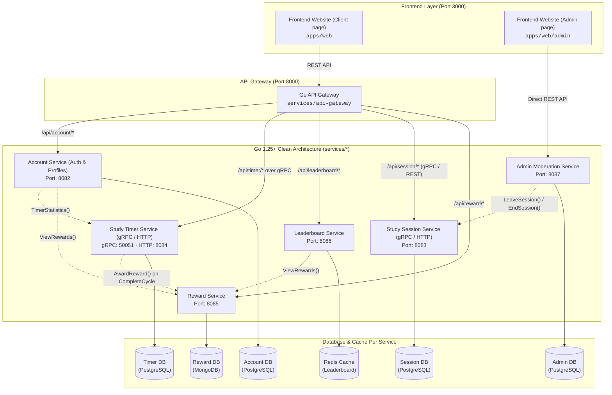

# Fisher Timer 🎣⏱️

> A community-based study timer platform with fishing-themed gamification ("FishTank") that combines individual time management with real-time peer accountability.

---

## 👥 Group Members (Software Architecture)

| No. | Student Name | Student ID |
| :---: | :--- | :---: |
| 1 | Chanatda Konchom | `6631305321` |
| 2 | Ittichet Thongsang | `6631363721` |
| 3 | Napat Srisamut | `6631314021` |
| 4 | Naphat Serirak | `6632061321` |
| 5 | Chayut Archamongkol | `6631307621` |

---

## 🏗️ System Architecture Overview

Fisher Timer is architected as a **polyglot microservices monorepo** managed by **Turborepo** and **pnpm workspaces**, featuring a **Next.js 16** frontend with separated Client and Admin portals, a dedicated Go **API Gateway**, and **7 Go microservices** built with **Clean / Hexagonal Architecture** with isolated per-service databases.



---

## ⚡ Architectural Decisions (ADR Summary)

- **ADR-001 (Frontend):** Next.js 16 (React 19) with App Router, server-side rendering, and built-in reverse proxy gateway.
- **ADR-002 (UI Framework):** TailwindCSS with shared component design system in `@repo/ui`.
- **ADR-003 (Backend):** Go (Golang) 1.25+ for high-concurrency timer synchronization and Hexagonal / Clean Architecture.
- **ADR-004 (Database):** Polyglot persistence: PostgreSQL (Supabase) for relational integrity & real-time presence; MongoDB for nested gamification rewards.
- **ADR-005 (Authentication):** Google OAuth 2.0 with stateless signed JWT verification across services.
- **ADR-006 (Deployment):** Docker containerization on Render. Locally, `docker-compose.yml` runs either just the data stores (`pnpm db:up`) or the whole system in containers (`pnpm docker:up`); see [Run everything in Docker](#-run-everything-in-docker-docker-compose).

---

## 🚀 Quick Start Guide

### Prerequisites
- **Node.js** `>= 22.x`
- **pnpm** `>= 9.x`
- **Go** `>= 1.25` (required by gRPC)
- **Docker & Docker Compose**

### 1. Clone & Setup Environment
```bash
git clone https://github.com/neennera/fishertimer.git
cd fishertimer

# Create local environment configuration
cp .env.example .env
```

### 2. Install Dependencies
```bash
pnpm install
```

### 3. Start Local Databases
Spins up PostgreSQL (`5432`-`5435`), MongoDB (`27017`), Redis, RabbitMQ and Adminer (`http://localhost:8088`) with their ports published on localhost, and automatically applies schema DDLs and seed datasets:
```bash
pnpm db:up
```

### 4. Start Development Servers
Runs Next.js web application and all 7 Go microservices concurrently:
```bash
pnpm dev
```
Visit **`http://localhost:3000`** in your browser.

---

## 🐳 Run everything in Docker (Docker Compose)

Runs the 7 Go services, the web app and every data store as containers on your machine. Containers find each other by Compose service name (`account`, `study-timer`, `reward-db`, ...), the same addresses the Kubernetes setup uses (`k8s/config.env`). Only the web app is published, on **http://localhost:3000**.

### Prerequisites
- **Docker** with Compose v2.24 or newer (about 4 GB of memory for it)
- Nothing else: Go and Node run inside the build

### 1. (Optional) Add your Google credentials
```bash
cp .env.docker.example .env.docker
```
Fill in `GOOGLE_CLIENT_ID` / `GOOGLE_CLIENT_SECRET` and add `http://localhost:3000/api/auth/google/callback` to the OAuth client's authorized redirect URIs. Without them the stack still starts; only Google sign-in fails. Settings are layered, later files win: `k8s/config.env` (shared ports and addresses) → `docker/app.env` (Compose overrides, development credentials) → `.env.docker` (yours, git-ignored).

### 2. Bring it up
```bash
pnpm docker:up       # build the images and start everything (first run takes a few minutes)
pnpm docker:ps       # every service should become "healthy"
```
Open **http://localhost:3000**. The stores are *not* published by default, so a PostgreSQL already running on your machine can't clash with them. Use `pnpm docker:dev` instead when you also want them (and the gateway on `:8000`, admin on `:8087`) on localhost for debugging.

### Day-to-day commands
```bash
pnpm docker:logs                     # follow all logs
docker compose logs -f reward        # one service
docker compose --profile app up -d --build reward   # rebuild and restart one service
pnpm docker:down                     # stop (data volumes are kept)
pnpm docker:reset                    # stop and wipe all data volumes
```
New `database/schemas` files only run when a volume is first created: after pulling one, run `pnpm docker:reset`.

### Service discovery with Consul (optional)
```bash
pnpm docker:discovery      # the same stack + a Consul agent, services find each other through it
```
Open **http://localhost:8500** to see every service register with its health check (`study-timer` and `study-timer-grpc` are the HTTP and gRPC ports of one service). Stopping a container removes it from the list at once; a crashed one drops out within seconds. `pnpm docker:up` goes back to plain addresses from the environment. How it works and how it fails: [`pkg/discovery/README.md`](pkg/discovery/README.md) and `docs/ARCHITECTURE.md` section 7.

### Hybrid mode: one service on your machine, the rest in Docker
Containers reach your machine as `host.docker.internal`. See the step-by-step example at the bottom of `.env.docker.example`.

### Notes
- `pnpm db:*` and `pnpm docker:*` share the same containers and volumes. `pnpm db:up` starts only the stores, so use it with `pnpm dev`.
- Don't run this together with `pnpm k8s:up` on a small machine; stop one first.

---

## ☸️ Run on Kubernetes (local kind cluster)

Runs the whole system (7 services, 6 data stores, the web app) on a local Kubernetes cluster, the way it would run in production. Independent of `pnpm db:up` / `pnpm dev`: stop the docker-compose containers first (`pnpm db:down` or `pnpm docker:down`) to save memory.

### Prerequisites
- **Docker** running (OrbStack or Docker Desktop), with ~6 GB of memory for it
- **kind**, **kubectl** and **helm**:
  ```bash
  brew install kind kubectl helm
  ```
- **pnpm** (see the Quick Start above)

### 1. Create your secrets
```bash
cp k8s/secrets.env.example k8s/secrets.env
```
Edit `k8s/secrets.env` (git-ignored):
- Pick a password for Postgres, MongoDB and RabbitMQ (letters and digits only, e.g. `openssl rand -hex 16`) and put each one in **every URL that uses it**.
- `JWT_SECRET`: `openssl rand -hex 32`
- `GOOGLE_CLIENT_ID` / `GOOGLE_CLIENT_SECRET`: from Google Cloud Console. Add `http://localhost/api/auth/google/callback` to the OAuth client's authorized redirect URIs (exactly `localhost`: Google refuses plain-http redirects to any other host).

### 2. Bring it up
```bash
pnpm k8s:up
```
Creates the cluster if needed, installs the front door (Traefik + Gateway API CRDs), builds and loads all images, applies `k8s/` and waits until every pod is ready. The first run downloads the database images and takes a few minutes. Safe to re-run after code changes: it rebuilds the images and restarts the apps.

Open **http://localhost**.

### 3. Tear it down
```bash
pnpm k8s:down
```
Deletes the cluster, **including all database data** (asks first). Images and `k8s/secrets.env` are kept, so `pnpm k8s:up` brings everything back.

### Day-to-day commands
```bash
kubectl -n fishertimer get pods                 # what's running
kubectl -n fishertimer logs deploy/account      # a service's logs
pnpm images reward                              # rebuild one image (and load it into the cluster)
kubectl -n fishertimer rollout restart deploy/reward   # run the rebuilt image
pnpm k8s:apply                                  # apply edits to k8s/
```

---

## 🔌 Microservice Port & API Routing Registry

Client requests route through the Go API Gateway (8000), while Admin requests communicate directly with the Admin Service (8087):

| Service | Internal Port | Gateway Route | Target Directory | Storage Engine |
| :--- | :---: | :--- | :--- | :--- |
| **Web Client** | `3000` | `/` | `apps/web` | - |
| **Admin Web** | `3000` | `/admin` | `apps/web/admin` | - |
| **API Gateway** | `8000` | `/api/*` | `services/api-gateway` | - |
| **Account** | `8082` | `/api/account/*` | `services/account` | Account DB (`account_db`) |
| **Study Session** | `8083` | `/api/session/*` (gRPC / HTTP) | `services/study-session` | Session DB (`session_db`) |
| **Study Timer** | `8084` (HTTP), `50051` (gRPC) | `/api/timer/*` (gateway calls it over gRPC) | `services/study-timer` | Timer DB (`timer_db`) |
| **Reward** | `8085` | `/api/reward/*` | `services/reward` | Reward DB (`reward_db`) |
| **Leaderboard** | `8086` | `/api/leaderboard/*` | `services/leaderboard` | Redis Cache (In-Memory) |
| **Admin** | `8087` | Direct (`/api/v1/admin/*`) | `services/admin` | Admin DB (`admin_db`) |

---

## 🛠️ Common Developer Commands

```bash
# Build all workspaces with Turborepo parallel caching
pnpm build

# Run unit tests across all 7 services & frontend
pnpm test

# Lint all code (ESLint + go vet)
pnpm lint

# TypeScript typechecking
pnpm check-types

# Database lifecycle commands
pnpm db:up       # Start the data stores with ports on localhost (for `pnpm dev`)
pnpm db:logs     # Follow container logs
pnpm db:down     # Stop database containers
pnpm db:reset    # Wipe volumes and re-apply schemas & seeds

# Whole system in Docker (web on http://localhost:3000)
pnpm docker:up     # Build images and start everything
pnpm docker:dev    # Same, plus stores/gateway/admin ports on localhost
pnpm docker:discovery # Same as docker:up + Consul (UI on http://localhost:8500)
pnpm docker:ps     # Status and health of each container
pnpm docker:logs   # Follow all logs
pnpm docker:down   # Stop (keeps data)
pnpm docker:reset  # Stop and wipe data volumes

# Regenerate Go code after editing proto/**/*.proto (needs protoc,
# protoc-gen-go and protoc-gen-go-grpc)
pnpm proto:gen
```

---

## 📚 Project Documentation Index

- **Phase 1 Deliverables:**
  - [`docs/phase1/project-desc.md`](docs/phase1/project-desc.md): Problem description, target personas, detailed use cases (UC-01 to UC-03), and ADRs.
  - [`docs/phase1/microservice.md`](docs/phase1/microservice.md): Service boundaries, operations, and collaboration matrix.
  - [`docs/phase1/turborepo.md`](docs/phase1/turborepo.md): Monorepo setup, task pipelines, and reproducibility guide.
- **Living Architectural Documents:**
  - [`docs/ARCHITECTURE.md`](docs/ARCHITECTURE.md): System architecture and data flow documentation.
  - [`docs/CHANGELOG.md`](docs/CHANGELOG.md): Semantic log of changes across services and packages.
  - [`docs/WAY_OF_WORK.md`](docs/WAY_OF_WORK.md): Engineering guidelines and testing standards.
  - [`docs/LESSONS_LEARNED.md`](docs/LESSONS_LEARNED.md): Knowledge base and incident log of resolved technical quirks.
- **AI Agent Skill Suite:**
  - [`docs/skill-set/`](docs/skill-set/): Specialized skills for agents maintaining this repo (explaining repo, documenting changes, architecture updates, way-of-work, database patterns, and migrations).
